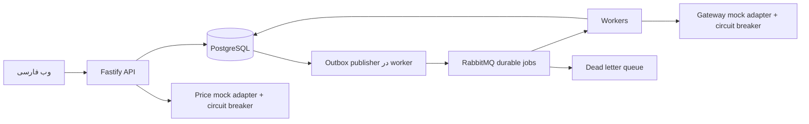
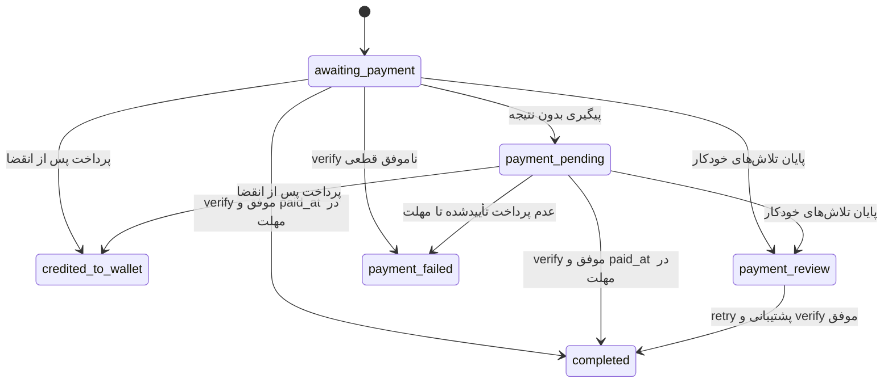

# Avand — معماری MVP و مسیر رشد

## ۱. دامنه و معماری روز اول

TypeScript / Node.js 22، Fastify، PostgreSQL 16، RabbitMQ 4، وب سادهٔ فارسی بدون framework. یک مخزن و دو فرایند API و worker؛ migration یک فرایند جداست. این انتخاب تعداد اجزای قابل نگهداری را برای تیم سه‌نفره کم نگه می‌دارد. در استخدام، مهارت SQL، تراکنش و TypeScript مهم‌تر از تجربهٔ میکروسرویس است.

ماژول‌ها: سفارش، دفترکل، قیمت، آداپتور درگاه، برداشت، تطبیق و پشتیبانی. مالک حقیقت PostgreSQL است. صف فقط محرک پردازش است. قیمت نمایشی ساختگی ثابت است؛ هر quote یک snapshot تغییرناپذیر با عمر ۶۰ ثانیه است. قیمت ساختگی روز اول ۱۰۰٬۰۰۰٬۰۰۰ ریال برای هر گرم است؛ این مقدار قیمت بازار نیست.

ساخته می‌شود: کاربر ثابت demo، خرید مستقیم با درگاه ماک، فروش به کیف پول، برداشت شبا با تسویهٔ ماک، همهٔ سناریوهای اصلی اختلال، دفترکل، تاریخچه و پشتیبانی. با کلیک «پرداخت موفق»، پرداخت در سرویس ماک ثبت می‌شود؛ فقط callback باعث تخصیص طلا نمی‌شود، verify لازم است.

ساخته نمی‌شود: اتصال واقعی، KYC، ورود واقعی، صندوق و کارت، پنل مدیریت کامل، پیامک، HA و استقرار عمومی. دمو به localhost محدود است. APIهای پشتیبانی و ماک احراز هویت ندارند و نباید روی شبکهٔ عمومی منتشر شوند.

## ۲. صحت مالی و دفترکل

ریال و میکروگرم طلا اعداد صحیح bigint هستند؛ API آن‌ها را به صورت رشته می‌گیرد و برمی‌گرداند. هر گرم = ۱٬۰۰۰٬۰۰۰ میکروگرم. موجودی از جمع entries به دست می‌آید و cache ندارد. قرارداد علامت دفتر: مثبت = بستانکار و منفی = بدهکار. user حساب بدهی به کاربر است و ماندهٔ مثبت آن حق کاربر را نشان می‌دهد؛ حساب دارایی مثل gateway:clearing به صورت ماندهٔ بدهکار منفی نگهداری می‌شود. trading:liquidity حساب واسط معامله است و در محصول واقعی با تسویهٔ طرف مقابل بسته می‌شود. نگاشت صورت‌های مالی قانونی باید با مالی نهایی شود.

حساب‌ها: user:demo، user:demo:reserved، gateway:clearing، trading:liquidity، revenue:fees، custodian:inventory، bank:settlement. در طراحی توسعه، suspense و custodian:settlement برای مغایرت و تسویهٔ واقعی جدا می‌شوند؛ در ماک، inventory نقش طرف مقابل طلا را دارد و موجودی خارجی یا پشتوانهٔ فیزیکی را اثبات نمی‌کند.

مثال‌ها با کارمزد ۱٪ و قیمت هر گرم ۱۰۰ میلیون ریال:

| رویداد | بستانکار (+) | بدهکار (−) |
|---|---|---|
| شارژ ۱۰ میلیون ریال | user ریال +۱۰ میلیون | gateway:clearing ریال −۱۰ میلیون |
| خرید با ۱۰ میلیون | gold user +۹۹٬۰۰۰ µg؛ liquidity +۹٫۹ میلیون ریال؛ fees +۱۰۰ هزار ریال | inventory −۹۹٬۰۰۰ µg؛ user −۱۰ میلیون ریال |
| فروش ۹۹٬۰۰۰ µg | inventory +۹۹٬۰۰۰ µg؛ user +۹٫۸۰۱ میلیون ریال؛ fees +۹۹ هزار ریال | user gold −۹۹٬۰۰۰ µg؛ liquidity −۹٫۹ میلیون ریال |
| پرداخت ناموفق قطعی | سند ندارد چون وجه دریافت نشده | — |
| پرداخت موفق پس از انقضا | user +کل وجه؛ gateway:clearing −کل وجه | خرید انجام نمی‌شود؛ وجه در کیف پول قابل برداشت است |
| اصلاح دستی ۱۰۰۰ ریال | user +۱۰۰۰ | suspense −۱۰۰۰؛ سند اصلاحی با دلیل و تأیید دو نفر، بدون ویرایش سند قبلی |

اصلاح دستی و بازپرداخت مستقیم به کارت در MVP endpoint ندارند. بازگشت به کیف پول با بازپرداخت به بانک یکی نیست و UI آن را صریح می‌گوید. در خرید، fee رو به بالا گرد می‌شود؛ مقدار طلا رو به پایین و هزینهٔ طلای تخصیص‌یافته رو به بالا گرد می‌شود؛ باقی ریالی در کیف پول می‌ماند. در فروش ارزش ناخالص رو به پایین و fee رو به بالا گرد می‌شود.

هر journal به ازای هر دارایی باید جمع صفر داشته باشد. اعتبارسنجی برنامه و constraint trigger تعویقی در commit این را کنترل می‌کنند. entries و journals اجازهٔ UPDATE/DELETE ندارند. دسترسی superuser دیتابیس در مدل تهدید عملیاتی باید جدا و ممیزی شود.

## ۳. خرید، وضعیت‌ها و پیام‌ها

قیمت در ثبت سفارش باید معتبر باشد. ملاک اجرای خرید، زمان پرداخت ثبت‌شده نزد درگاه است، نه زمان رسیدن callback. callback دیررس برای پرداخت به‌موقع همچنان خرید را با قیمت قفل‌شده نهایی می‌کند. پرداخت واقعاً پس از انقضا، بدون خرید به کیف پول ریالی می‌رود. این ریسک تعهد قیمت تا پایان قفل در دنیای واقعی نیازمند قرارداد price provider است.

هر Idempotency-Key در کیف پول یکتا و به payload نرمال‌شده متصل است؛ استفاده با payload متفاوت خطای 409 است. پاسخ اولیه در idempotency_responses داخل همان تراکنش ذخیره می‌شود؛ retry همان پاسخ اولیه را می‌گیرد، حتی پس از settlement. آخرین وضعیت از endpoint خواندن سفارش دریافت می‌شود.

رویداد callback ثبت و job ایجاد می‌شود. تراکنش مالی wallet را SELECT FOR UPDATE می‌کند، وضعیت سفارش را دوباره می‌خواند و با همان commit سند و وضعیت را می‌نویسد. تماس با درگاه بیرون این قفل انجام می‌شود. callback تکراری سند تکراری تولید نمی‌کند.

بدون callback، job از هنگام ایجاد سفارش وجود دارد و هر ۵ ثانیه استعلام می‌کند. عدم پرداخت پس از ۳۰ دقیقه و پاسخ موفق «یافت نشد» نهایی می‌شود. خطای ارتباطی، عدم پرداخت محسوب نمی‌شود؛ پس از retry محدود به بررسی پشتیبانی می‌رود. پرداخت پس از نهایی شدن به عنوان مغایرت گزارش می‌شود و خودکار خرید نمی‌سازد؛ این مورد نیازمند گردش بازپرداخت واقعی در توسعه است.

پیام‌ها: انتظار پرداخت، بررسی پرداخت تا ۳۰ دقیقه در حالت عادی، تکمیل موفق، عدم تأیید، و بازگشت وجه دیررس به کیف پول. هنگام قطعی هیچ وعدهٔ قطعی ۳۰ دقیقه‌ای داده نمی‌شود.

## ۴. صف، بازیابی و Circuit Breaker

ثبت سفارش و outbox یک تراکنش‌اند. publisher از FOR UPDATE SKIP LOCKED استفاده می‌کند؛ پیام persistent است و فقط بعد از publisher confirm زمان انتشار ثبت می‌شود. crash بین publish و commit ممکن است duplicate بسازد، بنابراین مصرف idempotent است. ack مصرف‌کننده پس از commit است. پیام‌های تمام‌نشده پس از lease شصت‌ثانیه‌ای دوباره منتشر می‌شوند؛ این بازیابی از broker loss هم کمک می‌کند.

خطای موقت: حداکثر ۸ تلاش، backoff نمایی تا ۶۰ ثانیه همراه jitter؛ سپس dead flag در دیتابیس و RabbitMQ DLQ. retry دستی job مرده از API پشتیبانی ممکن است. jobهای انتظار پرداخت بدون خطا هر ۵ ثانیه زمان‌بندی می‌شوند و بودجهٔ خطای شبکه را مصرف نمی‌کنند. outage طولانی نیازمند اقدام پشتیبانی است.

Circuit Breaker مستقل برای price و gateway با opossum: timeout=۱۵۰۰ms، آستانهٔ ۵۰٪ پس از حداقل ۳ درخواست در پنجرهٔ ۳۰ ثانیه، انتظار بازیابی ۱۰ ثانیه؛ سپس probe در half-open. خطای دامنه مثل پرداخت ردشده مدار را باز نمی‌کند. نتیجهٔ قیمت stale fallback مالی ندارد. قطعی درگاه وضعیت پول را تغییر نمی‌دهد.

مدارها process-local هستند؛ برای scale هر instance مدار مستقل دارد. وضعیت gateway در worker و قیمت در API باید جدا مشاهده شود؛ پنل snapshot مدار API و heartbeat مدارهای هر worker فعال در یک دقیقهٔ اخیر را جدا نشان می‌دهد. heartbeat هر پنج ثانیه ارسال می‌شود و وضعیت لحظه‌ای سراسری نیست.

## ۵. تطبیق و عملیات

job دستی صف‌شده در MVP، زمان‌بندی روزانه در نسخهٔ عملیاتی: تراکنش‌های paid درگاه در برابر journalهای topup، در یک snapshot دیتابیس. هر دو جهت missing و اختلاف مبلغ گزارش می‌شوند. گزارش immutable است؛ اصلاح مالی خودکار انجام نمی‌شود. نمونه: order A / gateway_only / ۱۰۰۰۰۰۰۰ ریال؛ order B / ledger_only / ۲۰۰۰۰۰۰۰ ریال. مغایرت تازه ممکن است ناشی از پردازش در حال انجام باشد؛ سن و وضعیت سفارش در بررسی لحاظ شود.

پیش از launch باید صورتحساب بانک در برابر clearing/settlement، و مانده و گردش طلای custodian در برابر مجموع تعهدات طلا تطبیق شوند. ماک فعلی این دو گزارش خارجی را ندارد. مالک بررسی: عملیات مالی؛ مالک خطای فنی: on-call. بستن مورد نیازمند دلیل، مرجع بیرونی و سند اصلاحی با تأیید دوم است.

runbook «پول کم شد، طلا نیامد»: شناسه سفارش را بگیر؛ events و jobs را بخوان؛ verify و زمان paid_at/expiry و مبلغ را بررسی کن؛ اگر gateway outage است job را بعد از بازیابی retry کن؛ اگر completed است سند buy و ماندهٔ مشتق‌شده را بررسی کن؛ اگر credited_to_wallet است تفاوت کیف پول و برگشت بانکی را توضیح بده؛ اگر درگاه paid و ledger خالی است وضعیت dead job و report را بررسی کن؛ بدون verify یا مدرک مالی طلا دستی اضافه نکن. مشکل مالی باز را به عملیات مالی ارجاع بده.

متریک‌های لازم: pending age، outbox lag، retry/dead count، callback latency، مغایرت، latency/error provider، وضعیت breaker، DB lock waits. هشدار پیشنهادی: هر journal نامتوازن فوراً؛ هر dead job مالی فوراً؛ pending بالای ۳۰ دقیقه؛ قدیمی‌ترین outbox بالای ۶۰ ثانیه. MVP لاگ ساختاریافته و پنل jobs/report دارد؛ stack مانیتورینگ و alert delivery هنوز پیاده نشده است.

## ۶. صندوق و کارت — فقط طراحی

صندوق: درخواست پذیره‌نویسی ریال را از available به reserved منتقل می‌کند؛ تا تأیید brokerage تعداد واحد قطعی نشان داده نمی‌شود. ابطال، واحدها را available→redemption_pending می‌برد؛ پس از تأیید مبلغ، receivable ثبت می‌شود و UI «در انتظار تسویه، ۱–۲ روز کاری» نشان می‌دهد. تنها پس از رسیدن پول، receivable به cash تبدیل می‌شود؛ شکست با سند معکوس و بدون حذف سابقه مدیریت می‌شود.

کارت: authorization تکرارپذیر با شناسه switch، رزرو ریال و پاسخ در deadline قراردادی بانک. کسری با فروش طلا تنها در صورت قیمت معتبر و تضمین نقدشوندگی فوری/خط اعتباری انجام می‌شود؛ settlement بیرونی async است. ابطال صندوق نقدشوندگی آنی ندارد و بدون اعتبار شریک بانک نمی‌تواند پرداخت چندثانیه‌ای را تأمین کند. timeout مبهم باید با inquiry/reversal حل شود؛ retry نباید دوباره دارایی بفروشد.

## ۷. امنیت و رشد

پیش از پول واقعی: احراز هویت و KYC، مجوز مالکیت سفارش، RBAC پشتیبانی، MFA کارکنان، دسترسی تولید از VPN/SSO با زمان محدود، مدیریت کلید در KMS/secret manager، TLS، تفکیک نقش دیتابیس و migration، redaction شبا و اطلاعات هویتی، audit بیرون دیتابیس عملیاتی، backup و آزمون restore، threat model، الزامات نهاد ناظر، گواهی امنیت و pentest مستقل. دمو هیچ ادعای تحقق این موارد ندارد.

API بدون session محلی افقی scale می‌شود؛ workerها با prefetch محدود اضافه می‌شوند؛ lock فقط روی کیف پول همان کاربر است (MVP فقط یک کیف پول دارد). ابتدا query/index و pool/connection budget اندازه‌گیری می‌شود؛ read replica فقط برای گزارش غیرحساس، نه تصمیم موجودی. دادهٔ دفترکل partition بر اساس زمان پس از اندازه‌گیری، و گزارش‌ها به مسیر جدا منتقل می‌شوند. نخستین جداسازی سرویس: reconciliation/reporting؛ سپس adapters پرداخت. استخراج دفترکل بدون نیاز سنجیده انجام نمی‌شود. PostgreSQL و RabbitMQ تک‌نود compose ظرفیت و HA تولید را اثبات نمی‌کنند.

## ۸. برنامهٔ ۱۲ هفته و ریسک‌ها

هفته ۱–۲: تصمیم مالی/حقوقی، مدل دفترکل، قرارداد providers، threat model. ۳–۴: سفارش، idempotency، اتصال sandbox، احراز هویت و KYC. ۵–۶: settlement/reconciliation، refund و support approvals؛ استخدام backend ارشد با تجربهٔ پرداخت تا هفته ۳. ۷–۸: frontend نهایی، load/chaos tests، backup/restore؛ استخدام platform/security engineer تا هفته ۶. ۹–۱۰: پایلوت محدود با عملیات مالی، observability و on-call؛ pentest مستقل. ۱۱–۱۲: اصلاح یافته‌ها، تأیید مالی/حقوقی/امنیتی و rollout محدود با kill switch. زمان launch تابع تأییدهای بیرونی است، نه صرفاً تقویم.

| ریسک | احتمال / اثر | اقدام / ساخت یا خرید |
|---|---|---|
| ثبت دوباره یا overspend | متوسط / بحرانی | تراکنش، unique، lock و تست هم‌زمانی؛ درون‌تیمی |
| قطعی و نتیجهٔ مبهم پرداخت | زیاد / زیاد | verify، outbox، breaker، reconciliation؛ منطق داخلی، provider قراردادی |
| طلای بدون پشتوانه یا settlement mismatch | متوسط / بحرانی | قرارداد custodian، سقف ریسک و تطبیق؛ شریک مجاز + کنترل داخلی |
| عدم مجوز یا گواهی امنیت | متوسط / بحرانی | مشاور حقوقی گروه، ارزیابی و pentest خریدنی؛ gate انتشار |
| دسترسی یا افشای داده | متوسط / بحرانی | KMS/SSO خریدنی، RBAC/audit داخلی، least privilege |

## منابع فنی

- https://www.postgresql.org/docs/current/explicit-locking.html
- https://www.rabbitmq.com/docs/confirms
